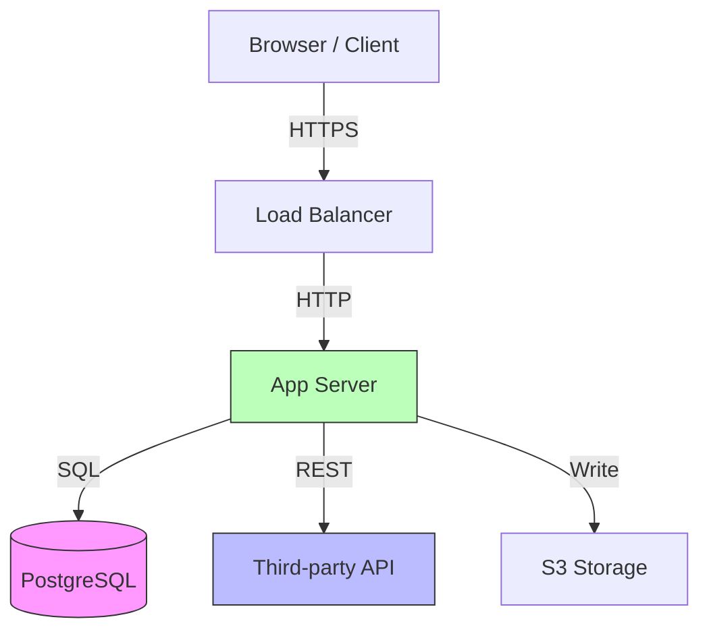

# Threat Model Skill

## Step 1: Determine Mode

Parse all arguments. Arguments can be combined: `/threat-model full --ci`

Set flags:
- `CI_MODE` = `true` if `--ci` present, otherwise `false`
- `FORCE_FULL` = `true` if `full` argument present, otherwise `false`

Then determine scope by checking for an existing `security-audit/threat-model.md`:

| Condition | Mode |
|---|---|
| No `security-audit/threat-model.md` exists | **Full** (regardless of argument) |
| `security-audit/threat-model.md` exists + no argument | **Incremental** (staged changes only) |
| `security-audit/threat-model.md` exists + `full` argument | **Full** (regenerate from scratch) |

**Why this matters:** Incremental mode keeps the threat model current without expensive full analysis on every commit. Full mode is needed for initial creation or when architecture changes significantly.

For **Incremental mode**, run `git diff --cached --name-only --diff-filter=ACM` to get staged files. If no staged files are found and `CI_MODE` is false, tell the user and offer to switch to full mode. If `CI_MODE` is true and no staged files are found, exit with a pass (nothing to analyse).

---

## Step 2: Read Reference Materials

Before analysing any code, read the reference files in this skill's `references/` directory. These contain the frameworks applied in Step 5.

- `references/stride.md` — STRIDE categories, per-category threat patterns, component-type matrix
- `references/owasp-top10-2025.md` — OWASP Web Top 10 (2025)
- `references/owasp-api-top10-2023.md` — OWASP API Security Top 10 (2023)
- `references/owasp-llm-top10-2025.md` — OWASP LLM Top 10 (2025) — **read only if AI/LLM features are detected**
- `references/cvss-scoring.md` — CVSS v3 scoring guide and worked examples
- `references/pytm-threats.json` — OWASP pytm threat library (113 curated threats). Each entry has: `SID` (unique ID), `target` (component types: Server, Process, Lambda, Datastore, Dataflow, LLM, ExternalEntity), `description`, `severity`, `condition` (security control properties that make the threat applicable), `mitigations`, and `references` (CAPEC/CWE links). Use this in Step 5 to cross-reference threats per component type.

**Why this matters:** Reading the reference material first ensures threat enumeration is systematic and consistent, not based on recall. The OWASP lists act as a checklist that prevents blind spots.

---

## Step 3: Application Discovery

### Full Mode

Systematically read the codebase to build an application profile. Read key files — do not just list them; understand what they do.

**1. Tech stack** — Read dependency manifests: `package.json`, `requirements.txt`, `go.mod`, `Gemfile`, `pom.xml`, `build.gradle`, `Cargo.toml`, `composer.json`. Note frameworks, major libraries, and runtime versions.

**2. Entry points** — Look for: route files in `routes/`, `controllers/`, `handlers/`, `views/`; top-level files like `app.py`, `server.js`, `main.go`, `index.ts`; CLI argument parsing; message queue consumers; scheduled jobs; file upload handlers; webhook receivers.

**3. Data stores** — Identify: ORM models in `models/`; raw SQL queries; Redis/cache clients; S3/blob storage; queue/topic definitions; search indexes.

**4. Authentication and authorisation** — Find: middleware in `middleware/`, `auth/`; JWT/session handling; OAuth flows; API key validation; role/permission checks and where they are enforced (or missing).

**5. External integrations** — Find: HTTP client calls to third parties; SDK imports; outbound webhooks; email/SMS senders.

**6. User roles and actors** — Look for: role enums, permission constants, distinct user types (anonymous, authenticated, admin, service account).

**7. Sensitive data** — Search for field/variable names containing: `email`, `password`, `ssn`, `dob`, `credit`, `card`, `health`, `pii`, `token`, `secret`, `key`, `private`, `api_key`.

**8. Trust boundaries** — Identify: where auth checks occur; what runs unauthenticated; what crosses network or process boundaries; what is exposed to the public internet vs. internal only.

**9. Component type classification** — Map each discovered component to the pytm taxonomy used in `references/pytm-threats.json`. This determines which threats apply at Step 5.

| pytm Type | Matches |
|---|---|
| Server | Web servers, app servers, API servers, load balancers |
| Process | Background workers, queue consumers, scheduled jobs, scripts |
| Lambda | Serverless functions, cloud functions |
| Datastore | Databases, caches (Redis), file storage, S3, queues |
| Dataflow | API calls, HTTP requests, database queries, message flows |
| LLM | Any AI/ML model endpoints, prompt handlers, embedding services |
| ExternalEntity | Third-party APIs, external users, browsers, mobile clients |

Also assess these security control properties for each component by reading its code — these map directly to pytm conditions:
- `sanitizesInput` — does the component sanitize/escape user input?
- `validatesInput` — does it validate types, lengths, formats?
- `encodesOutput` — does it encode output (HTML escape, parameterized queries)?
- `hasAccessControl` — is access control enforced?
- `authorizesSource` — does it verify the caller's identity/permissions?
- `checksInputBounds` — are buffer/size limits checked?
- `usesSessionTokens` — does it use session or JWT tokens?
- `protocol` — HTTP or HTTPS?

### Incremental Mode

Read only the staged files plus enough surrounding context:
- Read each staged file in full
- Read the existing `security-audit/threat-model.md` fully
- Identify which components in the existing model are affected by the changes
- Note new entry points, data flows, data types, or auth changes introduced

---

## Step 4: Architecture Synthesis

Build and write out the following. For incremental mode, update only the affected sections.

**1. Application summary** (2–3 sentences): what the app does, who uses it, what data it handles.

**2. Actor inventory** — table of all actors:

| Actor | Trust Level | Description |
|---|---|---|
| Authenticated User | Medium | Registered user with standard permissions |
| Admin | High | Internal operator with elevated access |
| Anonymous | None | Unauthenticated external party |
| External Service | Varies | Third-party API or webhook caller |

**3. Asset inventory** — table of what is worth protecting:

| Asset | Type | Sensitivity | Notes |
|---|---|---|---|
| User PII | Data | High | Names, emails, addresses |
| Auth tokens | Data | Critical | JWTs, API keys, session cookies |
| Payment data | Data | Critical | Card numbers, billing info |
| Admin endpoints | Functional | High | Can modify system state |
| Source code / IP | Infrastructure | Medium | Business logic |

Asset types: Data (PII, credentials, financial, health), Functional (admin endpoints, payment flows, config), Infrastructure (servers, CI/CD, secrets store).

**4. Data Flow Diagram** in Mermaid:



Colour coding: pink = data stores, blue = external services, green = internal components. Annotate arrows with protocol and auth method where known.

**5. Trust Boundary Map**:

| Boundary | Controls Present | Gaps / Notes |
|---|---|---|
| Internet → Load Balancer | TLS 1.3, WAF | DDoS protection? |
| Load Balancer → App Server | Internal network | No mTLS |
| App Server → Database | VPC, credentials | No encryption at rest confirmed |
| App Server → External API | HTTPS, API key | Key rotation policy? |

---

## Step 5: Threat Enumeration

Apply STRIDE **exhaustively** — every category against every significant component. Do not skip categories even when a threat seems unlikely; record it with a low score to show it was considered.

**For each component × STRIDE category:**
- State the threat scenario in one sentence grounded in the actual application
- Reference the relevant OWASP item if applicable
- Score: Likelihood (1–5) × Impact (1–5) = Risk Score (1–25)
- Note any existing controls already observed in the codebase (give credit)
- Note the CWE ID if known

**STRIDE categories** (see `references/stride.md` for full detail):
- **S**poofing — can an attacker impersonate a user, service, or component?
- **T**ampering — can data be modified in transit or at rest without detection?
- **R**epudiation — can actors deny performing actions? Are audit logs present?
- **I**nformation Disclosure — can sensitive data leak to unauthorised parties?
- **D**enial of Service — can availability be disrupted?
- **E**levation of Privilege — can an actor gain more permissions than intended?

After STRIDE, scan against the applicable OWASP list (Top 10 for web apps, API Top 10 for APIs, LLM Top 10 if AI features detected). Flag any OWASP items not already covered by STRIDE analysis.

**Cross-reference with pytm threat library:**

After completing STRIDE analysis, read `references/pytm-threats.json` and for each component:
1. Filter threats where the component's pytm type appears in the threat's `target` array
2. Evaluate the threat's `condition` against the control properties assessed in Step 3 — if the condition would evaluate to True (i.e. a control is absent), flag the threat
3. Add any flagged pytm threats not already captured by STRIDE analysis as new entries in the threat register, using the pytm `SID` as a cross-reference (e.g. `pytm:INP01`)
4. Use the pytm `mitigations` field to supplement remediation guidance in Step 7
5. Use the pytm `references` field to add CAPEC/CWE links to threat entries

This cross-reference catches threats that STRIDE enumeration might miss, particularly input validation attacks (INP category, 41 threats) and access control issues (AC category, 24 threats).

**Every threat entry MUST include either:**
- A code reference (file + line number or function name), OR
- The label `[Architectural inference — no direct code evidence]`

This grounds the model in reality and prevents generic or hallucinated threats.

---

## Step 6: Risk Register

Produce the full threat register table, sorted by Risk Score descending:

| ID | Component | STRIDE | Threat Scenario | Likelihood | Impact | Risk Score | OWASP Ref | CWE | Existing Controls | Status |
|----|-----------|--------|-----------------|------------|--------|------------|-----------|-----|-------------------|--------|
| T-001 | Login endpoint | Spoofing | Brute-force on POST /auth/login — no rate limiting observed in `src/auth/login.js` | 4 | 5 | 20 | A07:2025 | CWE-307 | bcrypt hashing present | Open |

Score ranges: Critical 20–25, High 12–19, Medium 6–11, Low 1–5.

For incremental re-runs: carry over all existing entries unchanged, add new entries for newly discovered threats, mark resolved entries as Mitigated if the staged changes addressed them.

---

## Step 7: Remediation Mapping

**High risks (Score ≥ 12):** Produce a detailed entry per threat:

```
### T-001: Brute-force on Login (Risk: 20 — Critical)
**File:** src/auth/login.js:34
**Threat:** No rate limiting on POST /auth/login allows credential stuffing attacks
**Remediation:** Implement rate limiting middleware (e.g. express-rate-limit).
  Limit to 5 attempts per IP per 15 minutes with exponential backoff.
**Effort:** Low (1–2 hours)
**OWASP:** A07:2025 — Identification and Authentication Failures
**Status:** [ ] Open
```

**Medium risks (Score 6–11):** Summary table with one-line remediation and effort estimate.

**Low risks (Score 1–5):** Group and note as accepted/monitor with brief rationale.

---

## Step 8: Write security-audit/threat-model.md

Create the `security-audit/` directory if it does not exist (`mkdir -p security-audit`). Save to `security-audit/threat-model.md`.

**Full mode:** If an existing `security-audit/threat-model.md` exists, first copy it to `security-audit/threat-model-YYYYMMDD-HHMMSS.md` as a snapshot, then overwrite.

**Incremental mode:** Update `security-audit/threat-model.md` in-place. Add a changelog entry at the top:

```markdown
## Changelog
- **2026-03-25** — Incremental update: analysed staged changes to `src/auth/login.js`. Added T-019, updated T-007 to Mitigated.
```

**Document structure:**

```
# Threat Model — [Application Name]

> Last updated: [date] | Mode: Full / Incremental | Version: N

## Changelog
## 1. Application Overview
## 2. Actors
## 3. Assets
## 4. Data Flow Diagram
## 5. Trust Boundaries
## 6. Threat Register
## 7. High-Risk Remediations
## 8. Medium-Risk Summary
## 9. Accepted / Low Risks
## 10. Security Scan Cross-Reference
```

For Section 10: if `security-audit/security-scan-report.md` exists in the current directory, read it and cross-reference scan findings with threat register entries. Note which scan findings map to which threat IDs, and which scan findings represent new threats not yet in the register.

---

## Step 9: Summary to User

After saving, present:
- Total threats found, broken down by severity (Critical / High / Medium / Low)
- Top 3 highest-risk items (ID, scenario, score)
- Count of open remediations
- Path to the saved file
- For incremental runs: what changed vs. the previous run

### CI Mode Exit

When `CI_MODE` is true, output a structured one-line summary as the final line:

```
THREAT MODEL: N threats (C critical, H high, M medium, L low), R open remediations — report: security-audit/threat-model.md
```

Then determine the exit outcome:
- **Any Critical or High threats without an accepted mitigation** → signal failure. Tell the user: "CI mode: threat model FAILED — unmitigated Critical/High threats present."
- **No unmitigated Critical/High threats** → signal success. Tell the user: "CI mode: threat model PASSED."

Threats with status `Mitigated` or `Accepted Risk` (with a documented reason) do not count as failures.
